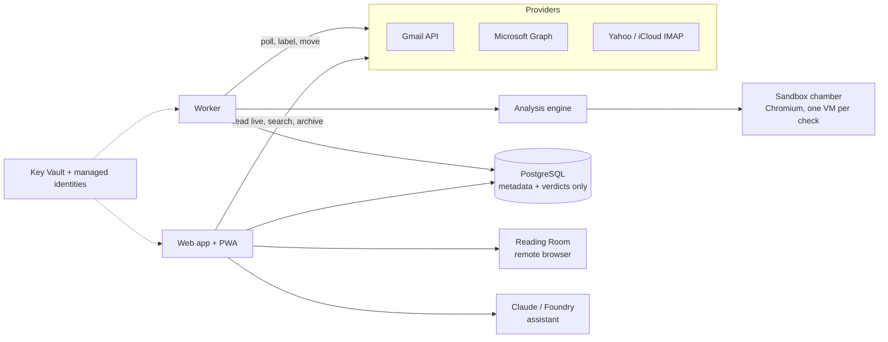

# Secureddy

**A bodyguard for your inbox.** Secureddy opens every link and file in your
email inside a throwaway sandbox before you see it, then tells you in plain
words whether it is safe. Dangerous mail is moved out of the way. Links you
still want to see open in a remote browser that only streams pictures to you.

It is built for people on everyday mailboxes (Gmail, Outlook.com and
Microsoft 365, Yahoo, iCloud) where company email security does not reach.
We built it for ourselves and the people close to us first; it is open source
so you can run it too.

> Screenshots: add `docs/img/home.png`, `docs/img/accounts.png`,
> `docs/img/read.png` and `docs/img/ask.png` here.

## What it does

- **One account, many mailboxes.** Connect Gmail and Outlook in one click,
  Yahoo in three short steps. Each mailbox has the same options: open inbox,
  pause, reconnect, re-check the last 7 days, trusted and blocked senders,
  sign out of that mailbox. See them together in one list or separately.
- **Only email with something to click or open.** An email with a link, a
  button, a QR code or a file is checked. Plain text email has nothing for
  the sandbox to open, so it is not checked, not labelled and not counted.
  In Settings you can also turn on "Also watch text-only emails for money
  scams" (off by default) to catch wire-transfer and gift-card requests that
  come with no link at all.
- **Checks before you click.** Sender checks, look-alike domains, QR codes,
  dangerous attachments, wire-fraud wording, and a real Chromium sandbox that
  follows every redirect. Every email gets a verdict, Checked or Suspicious,
  with the reasons; the dangerous ones are also moved out of your inbox (into
  a Secureddy Quarantine folder in Gmail, Outlook or Yahoo).
- **Home at a glance.** Two numbers, Checked and Suspicious, for Today, 7
  days, 1 month or 1 year, with a small chart and how many emails were
  checked. The choice is remembered and applies to the Email list too.
- **Read your mail safely.** Open an email inside Secureddy: it is fetched
  live, cleaned, and shown in a locked-down frame. Remote images stay blocked
  until you ask. Every link goes through a check page that says "safe to
  open", "open in the Reading Room" or "do not open".
- **Search.** Search what we checked, or tick "Search inside emails" to ask
  Gmail, Outlook or Yahoo too. Archive, mark read, delete (to Trash) and
  "Reply in Gmail" from the same screen.
- **Ask Secureddy.** A chat assistant (Claude, Azure AI Foundry or Azure
  OpenAI) that answers about *your* mail only: "show me the most suspicious
  emails", "search my Walmart emails", "is this link safe?". Answers stream in
  with cards you can tap. It can only suggest actions; you confirm them.
- **Learns from you.** "Not suspicious?", "Not fake?" and "This is fake"
  teach it which senders to trust, and it still checks everything they send.
- **Private by design.** Mail bodies are never stored. You stay signed in
  until you sign out, and you can add an app lock (PIN, password, passkey or
  authenticator code). Installs on iPhone and Android as an app.
- **Two-step sign-in.** Turn it on in Settings → Security: scan the QR code
  with Microsoft Authenticator (Add account → Other account (Google, Facebook,
  etc.) → Scan QR code), Google Authenticator or Authy, confirm one code, and
  keep the 10 recovery codes. Every sign-in (Google, Microsoft, Yahoo or
  password) then asks for the 6-digit code; a device can be remembered for 30
  days.
- **Light, dark or match the device**, chosen in Settings and remembered for
  your account.

## Who can use it

Secureddy is free (no payments anywhere) and run for a handful of people:
at most `RS_MAX_USERS` accounts (5 by default). Sign-up is invite-only by
default: an admin invites an email address on the **People** page (or with
`reddysec invite <email>`), and that person signs in with Google, Microsoft or
Yahoo using exactly that verified address. People who already have an
account are never locked out. On a new server, the account whose email is
`RS_BOOTSTRAP_ADMIN_EMAIL` becomes the first admin when it signs in. Admins
can withdraw invites, turn accounts off and on, and change roles; every
action is in the audit log.

## How it fits together



- `src/reddysec/models` shared data contracts (start here)
- `src/reddysec/mail` Gmail, Microsoft Graph and IMAP connectors; Google,
  Microsoft and Yahoo sign-in
- `src/reddysec/analysis` parsing, URL and attachment analysis, scoring
- `src/reddysec/chamber` sandbox backends (local, Docker, Azure Container
  Instances) and the Reading Room
- `src/reddysec/worker` the processing loop and the dead man's switch
- `src/reddysec/web` FastAPI app: accounts, reports, reading view, search,
  sessions and app lock, the PWA
- `src/reddysec/assistant` "Ask Secureddy": tools, agent loop, model clients
- `infra/azure` Bicep for Azure Container Apps; `docker/` images and compose

## Quick start (Docker)

```bash
cp .env.example .env              # fill in at least one sign-in provider
docker compose -f docker/docker-compose.yml up --build
open http://localhost:8000
```

For a local run without Docker:

```bash
python -m venv .venv && source .venv/bin/activate
pip install -e ".[dev]"
python -m playwright install chromium
cp .env.example .env
reddysec init-db
reddysec web          # http://localhost:8000
reddysec worker       # in a second terminal
```

`RS_DEV_LOGIN_ENABLED=true` adds a password-less developer sign-in for local
testing. It is refused in production.

Provider setup: [Google](docs/google-oauth-setup.md),
[Microsoft, Yahoo, iCloud](docs/yahoo-icloud-outlook-setup.md).

## Self-hosting on Azure

The Bicep templates deploy Container Apps (web, worker, dead man's switch),
PostgreSQL, Key Vault, Blob Storage and an isolated subnet for sandbox
checks, all with managed identities and no stored Azure passwords.
Deployment-specific values (your URL, client ids, resource names) live only in
`infra/azure/*.bicepparam`. Start with [docs/azure-deploy.md](docs/azure-deploy.md),
then [docs/claude-keyless-setup.md](docs/claude-keyless-setup.md) to use Claude
without any API key. Rough costs are in [docs/cost-estimate.md](docs/cost-estimate.md).

## Configuration

All settings are environment variables starting with `RS_` (or a `.env`
file). The full list with comments is in [.env.example](.env.example); the
most important ones:

| Setting | What it does |
|---------|--------------|
| `RS_ENV` | `dev`, `test`, `staging` or `prod` (prod turns on Secure cookies and HSTS) |
| `RS_BASE_URL` | The public address, used for OAuth redirects and passkeys |
| `RS_SECRET_KEY` | Signs the flow cookie, link checks and image links (Key Vault in prod) |
| `RS_TOKEN_KEK` | 32-byte key that encrypts mailbox tokens and app passwords |
| `RS_DATABASE_URL` | SQLite for development, PostgreSQL in production |
| `RS_GOOGLE_CLIENT_ID` / `_SECRET` | Sign in with Google and connect Gmail |
| `RS_MICROSOFT_CLIENT_ID` / `_CLIENT_CERT` / `_CERT_THUMBPRINT` | Sign in with Microsoft (certificate auth) and connect Outlook |
| `RS_YAHOO_CLIENT_ID` / `_SECRET` | Sign in with Yahoo (mail connects with an app password) |
| `RS_SANDBOX_BACKEND` | `local`, `docker` or `aci` |
| `RS_ASSISTANT_PROVIDER` / `RS_ASSISTANT_MODEL` | `anthropic`, `azure_foundry` or `azure_openai`, and the model |
| `RS_ANTHROPIC_FEDERATION_RULE_ID`, `_ORGANIZATION_ID`, `_SERVICE_ACCOUNT_ID`, `_WORKSPACE_ID`, `_WIF_AUDIENCE`, `RS_AZURE_IDENTITY_CLIENT_ID` | Keyless Claude via Workload Identity Federation |
| `RS_ANTHROPIC_API_KEY` | Claude with a static key (fallback; prefer keyless) |
| `RS_SESSION_IDLE_DAYS` / `RS_SESSION_ABSOLUTE_DAYS` | How long a device stays signed in (90 / 365) |
| `RS_HOLD_DEAD_MAN_MINUTES` | Hold mode releases everything if checks stop for this long |
| `RS_MAX_USERS` | Most accounts this server accepts (5) |
| `RS_SIGNUP_MODE` | `invite_only` (default) or `open` (anyone, up to the limit) |
| `RS_BOOTSTRAP_ADMIN_EMAIL` | While nobody is an admin, this account becomes one at sign-in |

## Security

Read [SECURITY.md](SECURITY.md) and [docs/security-model.md](docs/security-model.md).
Report vulnerabilities privately through the repository's Security tab.
Secrets are never committed: gitleaks runs in CI and as a pre-commit hook.

## Tests

```bash
pytest -m "not integration"   # unit + functional (+ PostgreSQL when it is installed)
pytest -m integration         # real Chromium: sandbox, Reading Room, the web app in a browser
pytest -m postgres            # against a real PostgreSQL
pytest --cov=reddysec
```

[TESTING.md](TESTING.md) says how to run each suite; [docs/test-plan.md](docs/test-plan.md)
lists every feature and the tests that cover it.

## Roadmap

- A Windows sandbox for Office and executable files (today they are analysed
  statically and turned into safe PDFs).
- A sandbox per Reading Room session.
- Yahoo Mail over OAuth (needs Yahoo's partner approval; app passwords work now).
- Sending and replying from inside Secureddy.
- Native push notifications for quarantined mail.

## License

[Apache License 2.0](LICENSE). See [NOTICE](NOTICE).
